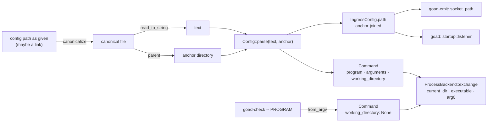
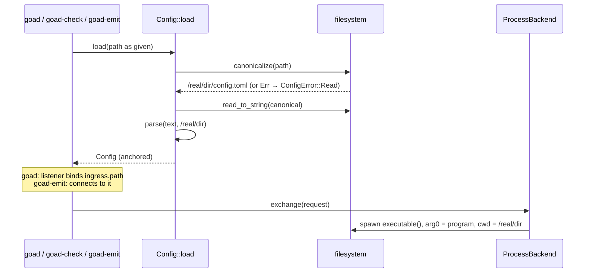

# Design — Slice 015: a config travels with its backend

<!-- The *current* design, not its history. Revision chronology, review
     findings, and dispositions live in `design-log.md`.
     Reference forms: canon by id (`SPEC-003 §4`, `ADR-007`, `POL-002`);
     doc-local refs bare — OQ-1 (§6), D1 (§7), R1 (§8). Ids are immutable. -->

**Tier:** 2. **Draft authority:** `canon-delta.md` (SPEC-001/R-60,
SPEC-003/R-17). Research: `research.md` (T-rows cited below).

## 1. Design problem

A relative path in a goad config means whatever directory goad happened to be
started in. Started by a service, a launcher, or through
`~/.config/goad/config.toml` (a link to a file elsewhere), goad finds nothing,
so every real config is absolute.

This slice makes one directory the anchor: **the directory of the config file,
every symbolic link in its path resolved.** The backend is spawned there, a
relative program with a `/` is located there, and a relative `ingress.path`
names a socket there. Arguments are never reinterpreted. `goad-check`'s argv
form, which has no file, keeps the caller's directory.

Boundary: stratum 2 (`goad-shell`: `config`, `backend::process`), prose and
the exerciser files and prose that state the old rule. No wire change, no new binary flag.

## 2. Current state

- `Config::load` reads and parses; the path is dropped (T2-1). `Command` is
  program + arguments (T2-2). `ProcessBackend::exchange` spawns with no
  `current_dir` (T2-3). `ingress.path` is kept as written and bound or
  connected to as written by goad and `goad-emit` (T2-7).
- Canon says nothing on any of it (T1-1, T1-3, T1-5). The kit says *make every
  path absolute* (T2-11). `exercisers/demo.toml` and the TypeScript README are
  repo-root relative (T2-10).

## 3. Forces & constraints

- **SPEC-001/R-36**: argv, no shell. Argv must not be reinterpreted (the
  permissive-parsing invariant: guessing which argument is a path is a guess).
- **SPEC-001/R-44**: an unstartable program stays *command not spawnable*, on
  the configuration's side.
- **SPEC-003/R-3, R-4, R-5**: lock before bind, every bind failure a startup
  failure naming the path, nothing unlinked.
- **SPEC-004**: a config that cannot be read exits 2; unchanged.
- **ADR-001**: all of it in stratum 2.
- **Platform**: Rust leaves a relative program under `current_dir`
  platform-specific (T2-S1); `sun_path` holds 107 bytes on Linux (T2-S5).
- **Settled** (`design-log.md` 2026-10-19): working directory (OQ-1), link
  target (OQ-2), `ingress.path` too (OQ-3), no way back (OQ-4), argv form keeps
  the caller's directory (OQ-5).

## 4. Guiding principles

- **One door.** The anchor is computed once, in `Config::load`; past it the
  canonical `Config` holds no path whose meaning depends on where a process
  started.
- **Resolve, don't reinterpret.** Only the values that *are* paths by
  definition — the program, when it has a `/`, and `ingress.path` — are
  joined onto the anchor. Arguments go through untouched.
- **No platform guessing.** What the child is executed from is decided by the
  host, not by how a platform orders `chdir` and `exec`.

## 5. Proposed design

### 5.1 System model



Ownership: `config` owns resolution (pure, over text and an anchor);
`Config::load` owns the one filesystem question (`canonicalize`);
`process` only applies what `Command` says.

### 5.2 Interfaces & contracts

```rust
// goad_shell::config
pub struct Command {
  pub program: String,              // as written; argv[0]
  pub arguments: Vec<String>,       // as written, never rewritten
  /// Where the backend runs. `Some(anchor)` for a command loaded from a
  /// file (SPEC-001/R-60); `None` for one with no file — goad-check's argv
  /// form, and tests — which runs where its caller runs.
  pub working_directory: Option<PathBuf>,
}

impl Command {
  pub fn new(program, arguments) -> Self;            // working_directory: None
  pub fn from_argv(argv) -> Option<Self>;            // unchanged; None directory
  pub fn in_directory(self, directory: PathBuf) -> Self;
  /// The path the host executes: `program` joined onto the working
  /// directory when it is relative and contains `/`; otherwise `program`
  /// (absolute, or bare and looked up on `PATH`). Pure.
  pub fn executable(&self) -> PathBuf;
}

impl Config {
  /// canonicalize(path) → read → parse(text, parent). `canonicalize` failing
  /// is `ConfigError::Read`, like `read_to_string` failing.
  pub fn load(path: &Path) -> Result<Self, ConfigError>;
  /// Relative paths in `text` resolve against `directory`, used as given.
  pub fn parse(text: &str, directory: &Path) -> Result<Self, ConfigError>;
}

/// `directory` joined with `path`, interior `.` components dropped
/// (`Path::components`); `..` kept. An absolute `path` is returned as is.
fn anchored(directory: &Path, path: &Path) -> PathBuf;
```

`anchored` is the one join, used by `Command::executable` and by
`ingress_config`. Dropping `.` keeps the socket path's byte length honest
(`./goad.sock` → `<dir>/goad.sock`, not `<dir>/./goad.sock`); `..` is not
folded, because folding it lexically is wrong across links.

`ProcessBackend::exchange` becomes, in substance:

```rust
let mut command = Command::new(self.command.executable());
command.arg0(&self.command.program).args(&self.command.arguments);
if let Some(directory) = &self.command.working_directory {
  command.current_dir(directory);
}
```

`ProcessBackend::new`'s signature is unchanged; so are its config-driven
callers, each `ProcessBackend::new(config.backend.command.clone(), …)` (T2-4).

**Errors.** No new variant anywhere.

| case | where | reported as |
|---|---|---|
| config path missing, dangling link, unreadable component | `Config::load`'s `canonicalize` | `ConfigError::Read` → each binary's existing *unreadable* arm, naming the path as given; exit 2 |
| anchor deleted or unsearchable after load | spawn | `BackendError::Spawn` (R-44, configuration's side) |
| relative program not beside the config | spawn | `BackendError::Spawn` `NotFound` |
| resolved socket path ≥ 108 bytes | `ingress::bind` | `BindFault::Unbindable` — `<path>: could not be bound: path must be shorter than SUN_LEN`; startup failure, exit 2 (SPEC-003/R-4) |
| same, in `goad-emit` | `connect` | its existing connect failure naming the path; exit 2 |

### 5.3 Data, state & ownership

- New datum: `Command::working_directory`, set once in `Config::parse` from the
  anchor `load` computed. Immutable afterwards.
- `IngressConfig.path` is now always anchor-resolved when it came from a file.
  `goad-emit --socket` stays the caller's, as given (a command-line argument,
  not configuration).
- Derived, not stored: `Command::executable`.
- Repo state: the demo socket moves to `exercisers/goad-demo.sock` (+ `.lock`).
  `.gitignore` swaps its root entries for `/exercisers/goad-demo.sock` and
  `/exercisers/goad-demo.sock.lock`. The stale root pair on any existing
  checkout is deleted by hand (the root `.lock` would otherwise show as
  untracked: T2-S7).

### 5.4 Lifecycle & dynamics



The file read is the canonical path, so the text and the anchor come from the
same resolution. Resolution happens once per process; nothing re-resolves on a
later exchange (no hot reload exists).

### 5.5 Invariants, assumptions & edge cases

- **I-1** Every `Command` built from a file has `working_directory:
  Some(absolute)`. Held by `load` and the tests in §9; `parse` takes the
  directory as given, and only `load` and tests call it.
- **I-2** The child's argv is exactly `[program, arguments…]` as written.
- **I-3** goad and `goad-emit` (without `--socket`) derive the socket path
  from the same `Config::load`, so they agree wherever each starts.
- **Edge — bare program.** `python3` is looked up on `PATH`, never beside the
  config. A relative `PATH` entry is the environment's and resolves however
  the platform resolves it under the new working directory; not defended.
- **Edge — `..`.** `../shared/run.sh` is joined, not folded, so it means the
  directory above the *link target's* directory.
- **Edge — `/nix/store` config.** Read-only working directory (OQ-2's stated
  cost).
- **Edge — long socket path.** The lock file is created before the bind fails
  and, by R-5, is left. Remedy in the kit: an absolute `ingress.path` somewhere
  short (`$XDG_RUNTIME_DIR`).
- **Edge — the argv form.** `goad-check -- ./backend.sh` runs `./backend.sh`
  from the caller's directory, unchanged; `checking.md` says so (OQ-5).
- **Assumption A-1** The anchor of a canonical, readable file always exists
  (`Path::parent` of a canonical file path is `Some`). The code states the
  impossible arm without a panic; the plan picks the spelling.

## 6. Open questions

OQ-1 … OQ-5 are settled in `slice-015.md` and `design-log.md`. None raised
here.

## 7. Decisions, rationale & alternatives

| id | chosen | rejected | why |
|---|---|---|---|
| D1 | The working directory lives on `Command` (`working_directory: Option<PathBuf>`). | A field on `BackendConfig` with a new `ProcessBackend::new` parameter; a `ProcessBackend::from_config`. | `Command` is *what to spawn and where*, as std's is. Every config-driven spawn already passes `config.backend.command` (T2-4), so the directory arrives without editing either `main.rs`; the argv form and test-built commands get `None`, which is today's behaviour, by construction. |
| D2 | `None` means *the caller's directory*; there is no captured `current_dir()`. | `std::env::current_dir()` in the argv form. | Capturing adds a failure (a deleted cwd) to a path that has none today, to say the same thing. |
| D3 | `Config::parse(text, directory)`. | `parse(text)` returning unresolved paths, resolved in `load`. | Keeps one door: no `Config` value carries a start-dependent path, and resolution is unit-testable without a filesystem. Cost: each caller T2-6 names passes a directory. |
| D4 | `canonicalize` first, then read the canonical path; its failure is `ConfigError::Read`. | A new `ConfigError` variant and message. | Same subjects as `read_to_string`'s failure (missing, dangling, unreadable), same message; SPEC-004's exit 2 unchanged. Reading the canonical path ties text and anchor to one resolution. |
| D5 | A relative program with `/` is executed as `anchored(dir, program)`, with `arg0(program)`. | Rely on the platform under `current_dir` (correct on Linux today, T2-S1). Rewrite `program` at load. | Rust documents the platform behaviour as unstable. `arg0` keeps the child's argv as written (I-2), which a rewrite at load would not. The cost is one line; a script's `$0` becomes the absolute path either way (T2-S2). |
| D6 | No `/` → `PATH`, as a shell does. | Resolve every relative program beside the config. | `["python3", "backend.py"]` must keep meaning the interpreter; the `/` rule is execvp's. |
| D7 | `anchored` drops interior `.` and keeps `..`. | `Path::join` alone; full lexical normalization. | `./goad.sock` must not cost bytes of `sun_path`; folding `..` lexically is wrong through links. |
| D8 | No length check of our own; R-4's `Unbindable` refuses it, pinned by a test. | A load-time check of the resolved socket path's length. | The limit is the platform's (107 on Linux, 103 on macOS); a second statement of it is a parallel implementation. The existing message names the path and the reason. |
| D9 | Demo: `command = ["bash", "shell/backend.sh"]`, `path = "./goad-demo.sock"` (→ `exercisers/`). `justfile` `emit` passes `--socket exercisers/goad-demo.sock`. | `path = "../goad-demo.sock"` (keeps the root socket and every comment). | Settled scope says relative to `exercisers/`; a config reaching outside its directory is what this slice exists to stop recommending. |
| D10 | The TypeScript README's config becomes `["deno", "run", "-A", "backend.ts"]`, *saved beside `backend.ts`*; its test parses it with `exercisers/typescript` as the directory and `rooted_at_the_workspace` is deleted. | Keep the repo-root path and the rebasing helper. | The helper existed to work around the old rule; under the new one the README's own text is the test's input with no rewriting. |
| D11 | AC-1 is held through `Config::load` + `ProcessBackend` in `goad-shell` integration, AC-2 through the built `goad-check`, AC-4 by a person. No binary-tier test of `goad` itself. | A headless `goad` binary case. | goad's binary reaches a window; its config path to the spawn is the same `Config::load` → `config.backend.command` → `ProcessBackend::new` that `goad-check` runs (T2-4). Residue: `goad`'s own `main.rs::start` is held by review and AC-4 only. |

## 8. Risks & mitigations

| id | risk | likelihood / impact | mitigation | signal |
|---|---|---|---|---|
| R1 | 012's PHASE-10 edits the same kit files. | high / merge pain | Kit and exerciser prose phase runs after 012 PHASE-10 lands (slice *Depends on*); code phases do not wait. | 012 notes status table. |
| R2 | 012's design (§5.2.1, F-36) and walk procedure state the old rule. | certain / stale record | 015 does not edit 012's design; it is a record. 012's audit lists it under *design drift*; 015's audit names the hand-off. | grep `F-36` in 012 at its audit. |
| R3 | A socket path that fit relative no longer fits absolute (deep checkout, long `TMPDIR` in a jail). | low / startup failure | Refused loudly (D8); the kit says the limit and the remedy. Tests build socket paths under `std::env::temp_dir()`. | `could not be bound: path must be shorter than SUN_LEN`. |
| R4 | SATAN's configs, which link into `~/satan-corpus`, change meaning. | none today — absolute | Owner's edit after ship. | — |
| R5 | A test writes a socket into a crate directory during its red run. | medium / litter | The red case asserts the path's absence and removes it; names carry the pid. | `git status` after the red step. |

## 9. Validation

Red first for each behaviour row; *pin* rows are green on arrival because the
behaviour exists and is untested, and each says what would turn it red.
Integration cases run with the test binary's working directory (the crate)
**different** from the config's, which is what makes them red today.

| AC | test (full path::name) | what it shows | red today because |
|---|---|---|---|
| AC-1 | `crates/goad-shell/tests/integration/working_directory.rs::a_relative_argument_resolves_beside_the_config_from_another_directory` | `["bash", "backend.sh"]` loaded by `Config::load` answers; the `pwd -P` it logs is the canonical config directory and its `$0` is `backend.sh` as written | bash cannot open `backend.sh` in the crate dir |
| AC-1 | `…/working_directory.rs::a_linked_config_runs_its_backend_beside_the_target` | over a link to the file **and** a link in a directory component, the target directory's backend runs; a decoy `backend.sh` beside the link answers differently | old rule: decoy or nothing; a link-directory implementation: decoy |
| AC-1 | `…/working_directory.rs::a_relative_program_with_a_slash_resolves_beside_the_config` | `["./backend.sh"]` (shebang) answers | spawn `NotFound` |
| AC-1 | `…/working_directory.rs::a_program_with_no_slash_is_never_looked_for_beside_the_config` | an executable `goad-decoy` beside the config, `command = ["goad-decoy"]` → `BackendError::Spawn` `NotFound` | pin; red under an implementation that anchors bare names |
| AC-1 | `…/working_directory.rs::the_backend_receives_its_program_as_written` | `["./shell", "-c", …]`, `shell` a link to `sh`, logs `$0` = `./shell` | spawn `NotFound`; and once D5's join lands, red again without `arg0` (argv[0] absolute) |
| AC-1 | `crates/goad-shell/src/config.rs::tests::a_relative_path_resolves_against_the_directory_given` | `parse(text, "/anchor")`: `ingress.path` `./goad.sock` → byte-exact `/anchor/goad.sock`; absolute kept; `working_directory` is `/anchor` | no such parameter |
| AC-1 | `config.rs::tests::the_executable_is_anchored_only_for_a_relative_path_with_a_slash` | table: `./b.sh`, `bin/b`, `../b`, `/abs/b`, `python3`, and `./b.sh` with `None` | no `executable` |
| AC-1 | `config.rs::tests::a_dangling_link_to_a_configuration_is_unreadable` | `load` over a dangling link → `ConfigError::Read` | pin (`read_to_string` gave the same); red under D4's rejected variant |
| AC-2 | `crates/goad-check/tests/kit/examples.rs::each_shipped_example_is_accepted_by_the_checker` (and `::downloads_triage_moves_the_file_it_was_asked_about`) | `run_checker` now starts in the hand-out **root** with `--config example/config.toml` and `--event example/events/…` | breadcrumbs' `backend.ts`, triage's `backend.sh`, focus-check's `backend.py` are not in the root |
| AC-2 / OQ-5 | `crates/goad-check/tests/binary/run.rs::the_argv_form_runs_a_relative_program_from_the_caller_s_directory` | `goad-check -- ./backend.sh` from a directory holding it is judged | pin; holds `checking.md`'s argv-form sentence |
| AC-3 | review at audit: SPEC-001 R-60 and SPEC-003 R-17 promoted with their §7 rows; `grep -rn "absolute\|started in" kit/skills/goad-backend` shows no *make paths absolute* advice | — | — |
| AC-4 | person: `cd /tmp && goad <repo>/exercisers/demo.toml` (and through a link to it), a view appears; `just emit …` from the repo root reaches it | `audit.md` Evidence | — |
| AC-5 | `crates/goad/tests/renderer/startup.rs::listener::a_relative_configured_path_binds_beside_the_config` | `Config::load` of a temp config with `./goad.sock`, then `listener(…)`: a socket at the canonical directory, none in the crate dir | binds in the crate dir |
| AC-5 | `crates/goad-emit/tests/binary/exchange.rs::a_relative_configured_socket_is_found_beside_the_configuration` | `XDG_CONFIG_HOME` → temp, config names `./goad.sock`, fake listener at the config's directory, `goad-emit` started elsewhere without `--socket` → exit 0, envelope received | connects in its own cwd: exit 2 |
| AC-5 | `crates/goad-emit/src/main.rs::tests::a_configured_ingress_path_is_what_is_written_to` | expected value becomes the canonical config directory joined with `from-config.sock` | asserts `./from-config.sock` today |
| R-4 pin | `crates/goad-shell/tests/integration/ingress.rs::a_path_longer_than_a_socket_address_holds_is_refused_naming_the_path` | a 108-byte path → `Unbindable`, message names the path and `SUN_LEN`; a 107-byte path in the same directory binds (the control) | pin; red if the length case were ever filed elsewhere |

Existing tests changed, not added: `round_trip.rs::the_readme_s_own_config_loads_and_runs_the_example`
(D10), `host.rs::host` and `startup.rs` `unparseable` and `tagged.rs::check`
(pass a directory: for `tagged.rs`, the markdown file's own directory). Unchanged and
still green: T2-9's *unaffected* list. `transport_shape.rs::the_only_spawn_is_the_child`
still finds `let mut command = Command::new(` (§5.2).

**Negative controls compile**: every decoy and control above is a case in the
same file, built and run, never a commented-out variant.

## 10. Canon impact

- **SPEC-001** — amended (`canon-delta.md`): new **R-60** in §4 *Process
  transport*; one paragraph in §6.4; R-60's §7 row. R-36's text and row
  unchanged. R-59 is left to slice 012.
- **SPEC-003** — amended: new **R-17** in §4; one paragraph in §6.1; R-17's
  §7 row; §9 cites SPEC-001/R-60.
- **SPEC-002** — checked, not affected.
- **SPEC-004** — checked, not affected: an unreadable config and an unbindable
  socket stay exit 2; a spawn failure is not an exit.
- **POL-001**, **ADR-001**, **ADR-003**, **ADR-004**, **ADR-005** — checked,
  not affected.
- **Not canon, repaired in the slice:** kit `running.md`, `checking.md`,
  examples' configs/READMEs; `exercisers/demo.toml`,
  `exercisers/typescript/README.md`, `exercisers/shell/backend.sh` header;
  `justfile` (`emit`, `package` comment); `.gitignore`;
  `docs/memory/path-flake-ref-breaks-on-demo-socket.md` (the socket's new
  location; its conclusion — use the bare git form — stands, research X-4).
